# Vendor Payment Request & Approval Module

A small Laravel application for an internal business system. Staff submit vendor payment requests, and approvers review, approve or reject them. Every action is written to an audit trail.

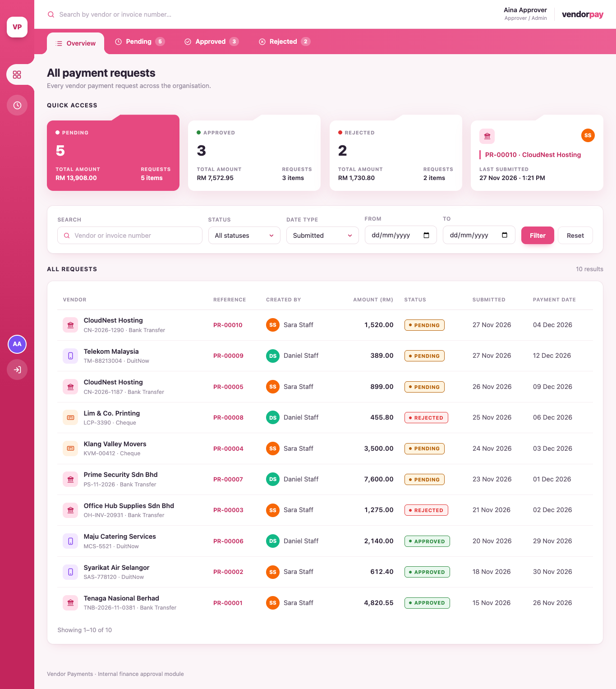

## Demo video

▶ **[Watch the 4-minute walkthrough](DEMO_VIDEO_LINK)**. It covers staff submitting a request, the approver approving one request and rejecting another with a reason, the audit trail, search and filters, and the role restrictions.

## Contents

- [Demo video](#demo-video)
- [Features](#features)
- [Tech stack](#tech-stack)
- [Setup](#setup)
- [Database configuration](#database-configuration)
- [Seeded credentials](#seeded-credentials)
- [Running the tests](#running-the-tests)
- [How it works](#how-it-works)
- [Assumptions](#assumptions)
- [Screenshots](#screenshots)

## Features

| Requirement | Implementation |
|---|---|
| Login / logout | Session login with CSRF, session regeneration on login, and throttling of 5 failed attempts per email + IP |
| Two roles | `staff` and `approver` (shown as "Approver / Admin"), stored on `users.role` |
| Staff see only their own requests | Every listing query is scoped by `PaymentRequest::scopeVisibleTo()`, and every single-record route is guarded by `PaymentRequestPolicy` |
| Approvers see all and approve / reject | `review` policy ability; approve and reject routes use `can:review` middleware |
| Request form | Vendor name, invoice/reference no., amount, payment method (Bank Transfer / DuitNow / Cheque), requested payment date, remarks, optional attachment |
| Workflow | New requests are **Pending**. Approvers move them to **Approved** or **Rejected**. A rejection **requires a reason**. Staff can't edit once a request is approved or rejected |
| Dashboard | Count and RM total per status, plus a table with reference, vendor, invoice no., amount, status, creator, submitted date and payment date |
| Search / filter | Search by vendor or invoice no. Filter by status and by a date range on either the submitted date or the payment date. Paginated, and filters survive paging |
| Audit trail | Records created / updated / approved / rejected with who, when, and (for edits) a before → after diff of each changed field |
| Validation | Form Request classes validate every input, including the listing filters |
| File protection | Attachments are stored outside `public/` on a private disk under random names, and downloaded only through an authorised controller action |
| Migrations & seeders | Schema migrations, demo users for both roles, and sample requests in every status |

## Tech stack

- **PHP 8.3+**, **Laravel 13** (meets the "Laravel 10 or above" requirement)
- **MySQL 8 / MariaDB 10.6+** (SQLite also works and is used by the test suite)
- Blade templates with one hand-written CSS file (`public/css/app.css`). There is **no Node/Vite build step**
- PHPUnit feature tests

## Setup

Prerequisites: PHP 8.3+ with `pdo_mysql`, `mbstring`, `fileinfo`; Composer; a MySQL or MariaDB server.

```bash
git clone <repo-url> vendor-payment-module
cd vendor-payment-module

composer install
cp .env.example .env
php artisan key:generate

# create the database first (see below), then:
php artisan migrate --seed

php artisan serve
```

Open <http://localhost:8000> and log in with one of the [seeded accounts](#seeded-credentials).

To reset the demo data at any time, run:

```bash
php artisan migrate:fresh --seed
```

> You **don't** need to run `php artisan storage:link`. Attachments are intentionally not on the public disk.

## Database configuration

Create an empty database and a user:

```sql
CREATE DATABASE vendor_payments CHARACTER SET utf8mb4 COLLATE utf8mb4_unicode_ci;
CREATE USER 'vendor_payments'@'localhost' IDENTIFIED BY 'change-me';
GRANT ALL PRIVILEGES ON vendor_payments.* TO 'vendor_payments'@'localhost';
```

Then set the connection in `.env`:

```dotenv
DB_CONNECTION=mysql        # use mariadb for MariaDB
DB_HOST=127.0.0.1
DB_PORT=3306
DB_DATABASE=vendor_payments
DB_USERNAME=vendor_payments
DB_PASSWORD=change-me

APP_TIMEZONE=Asia/Kuala_Lumpur
```

Sessions, cache and queue use the database driver (Laravel defaults), so their tables come from the same migrations.

**Quick try without MySQL:** set `DB_CONNECTION=sqlite`, remove the other `DB_*` lines, and run `touch database/database.sqlite` before migrating.

## Seeded credentials

All demo accounts use the password **`password`**.

| Role | Name | Email |
|---|---|---|
| Approver / Admin | Aina Approver | `approver@example.com` |
| Staff | Sara Staff | `staff@example.com` |
| Staff | Daniel Staff | `staff2@example.com` |

The seeder also creates 9 sample requests split across both staff members and all three statuses, each with its audit history. The login page lists these accounts only when `APP_ENV=local`.

> These accounts are for local demonstration only. Don't run the seeder against a production database.

## Running the tests

```bash
php artisan test
```

There are 28 feature tests, all running against in-memory SQLite. They cover:

- **Authentication:** login, logout, wrong password, and login throttling.
- **Access control:** staff see only their own requests, cross-user access returns 403, approvers can't create requests, and staff can't approve.
- **Workflow:** submission, rejection requires a reason, a finalised request can't be re-reviewed or edited, and a stale approval is refused.
- **Mass-assignment protection:** posting `status` or `user_id` has no effect.
- **Validation:** every field, plus duplicate-invoice protection.
- **Dashboard:** totals, search, filters, and invalid filter input.
- **Audit trail:** content and display, including no entry for a no-op save.
- **Attachments:** private storage, download authorisation, and cleanup when a file is replaced.

## How it works

```
app/
├── Enums/                    Role, PaymentStatus, PaymentMethod, ActivityAction
├── Models/
│   ├── User.php              role cast + isApprover()/isStaff()
│   ├── PaymentRequest.php    visibleTo() and filter() query scopes, logActivity()
│   └── PaymentRequestActivity.php   append-only audit row
├── Policies/PaymentRequestPolicy.php   view / create / update / review rules
├── Services/PaymentRequestService.php  create, update, approve, reject (+ audit) in transactions
└── Http/
    ├── Controllers/          LoginController, PaymentRequestController, PaymentRequestReviewController
    └── Requests/             LoginRequest, PaymentRequestFormRequest, RejectPaymentRequestRequest
```

**Permissions.** `PaymentRequestPolicy` is the single source of truth. Routes enforce it with `->can(...)` middleware, and Blade uses `@can` to hide buttons. Hiding a button is never the only protection: a direct POST still gets a 403.

| Ability | Staff | Approver |
|---|---|---|
| View list | own only | all |
| View one | own only | all |
| Create | ✔ | ✘ |
| Edit | own, while Pending | ✘ |
| Approve / reject | ✘ | Pending only, and never their own |

**Integrity of the workflow.** `PaymentRequestService` performs each state change and writes its audit row in **one DB transaction**, so neither can happen without the other.

- **Locking.** Approve, reject and edit re-read the row with `SELECT … FOR UPDATE` and re-check that it's still Pending. Two approvers clicking at once, or an edit racing an approval, can't both succeed.
- **Stale views.** The review form carries a version token, the request's `updated_at`. If staff edit the request after the approver opened it, the approval is refused with "this request was edited while you were viewing it". An approver can never approve an amount they didn't see.
- **Mass assignment.** `status`, `user_id`, `reviewed_by`, `reviewed_at` and `rejection_reason` aren't mass-assignable, and `role` isn't mass-assignable on `User`.

**Audit trail.** `payment_request_activities` is append-only: there's no `updated_at`, and no code path edits or deletes rows. An edit stores a JSON diff of only the fields that changed. Saving an unchanged form records nothing. The detail page shows the trail newest-first, with the actor's name and role, the exact timestamp and a relative time, any field changes, and the rejection reason.

**Uploaded files.**

- Files are stored on the `attachments` disk at `storage/app/private/attachments`, which is outside the web root.
- The disk has `serve => false`, so Laravel's built-in file route doesn't expose it either. The default `local` disk was switched to `serve => false` as well.
- Files are saved under a random name, with the extension derived from the detected MIME type. The original file name is kept only for display.
- Only PDF, JPG and PNG are accepted, up to 5 MB, and the type is checked against the file's content, not its name.
- Downloads go through `GET /payment-requests/{id}/attachment`, which applies the same `view` policy as the request. They're sent as `Content-Disposition: attachment` with `X-Content-Type-Options: nosniff` and `Cache-Control: private, no-store`.
- Replaced or removed files are deleted. If a transaction fails, the newly uploaded file is cleaned up.

**Other validation details.**

- Amount must be between 0.01 and 999,999,999.99, with at most 2 decimal places. Thousands separators such as `1,234.50` are accepted.
- The requested payment date can't be in the past.
- Invoice numbers are trimmed, upper-cased and limited to letters, digits, spaces and `- / . #`.
- Listing filters are validated too. An invalid filter is ignored and reported on the page rather than causing an error.

## Assumptions

1. **Only Staff create requests, and approvers only review.** This keeps requesting and approving separate. The policy also refuses self-approval, in case an approver ever becomes a requester.
2. **"Approver/Admin" is one role.** There is no separate user-management screen. Users are created by the seeder or with `php artisan tinker`.
3. **Currency is MYR (RM).** The payment methods (DuitNow) and the default timezone (`Asia/Kuala_Lumpur`) follow the same assumption.
4. **Staff can edit a Pending request, but there is no delete or cancel.** Deleting would break the audit trail. A request that shouldn't be paid is rejected instead.
5. **One rejected request is final.** To resubmit, staff create a new request. Duplicate-invoice protection ignores rejected requests, so the same vendor and invoice number can be resubmitted.
6. **Duplicate invoice rule.** The same vendor name and invoice number can't be Pending or Approved twice. Vendor names are free text: there's no vendor master table.
7. **The requested payment date must be today or later,** on both create and edit.
8. **Attachments are optional, one per request.** Allowed types are PDF, JPG and PNG, up to 5 MB.
9. **The dashboard totals ignore the active filters.** They always show the user's overall pending, approved and rejected counts. Clicking a total filters the table to that status.
10. **The date range filter** applies to the submitted date by default. A selector switches it to the requested payment date. Both ends are inclusive.
11. **Out of scope, as specified:** payment gateway, bank API, email notifications, PDF generation, accounting logic and deployment.

**Verification note:** the automated tests and the screenshots were run against SQLite on PHP 8.5. The queries use only portable Eloquent and query-builder calls (`whereDate`, `LIKE`, `GROUP BY`, `lockForUpdate`), and the schema uses standard column types. MySQL is the configured default in `.env.example`.

## Screenshots

All screenshots are in [`docs/screenshots/`](docs/screenshots). They were taken with headless Chrome against the seeded demo data.

| | |
|---|---|
| **Login**<br>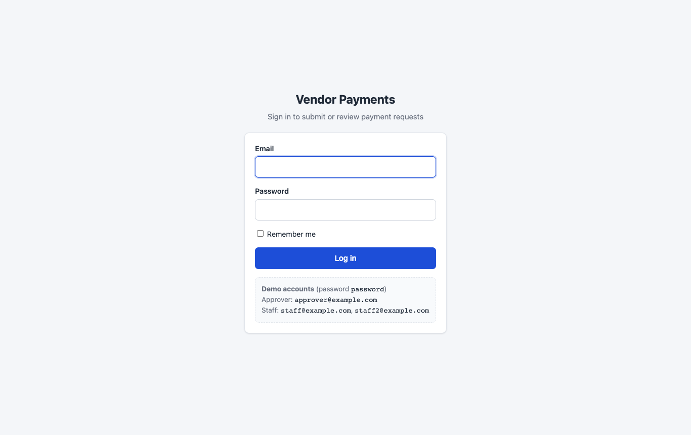 | **Staff dashboard** (own requests only)<br>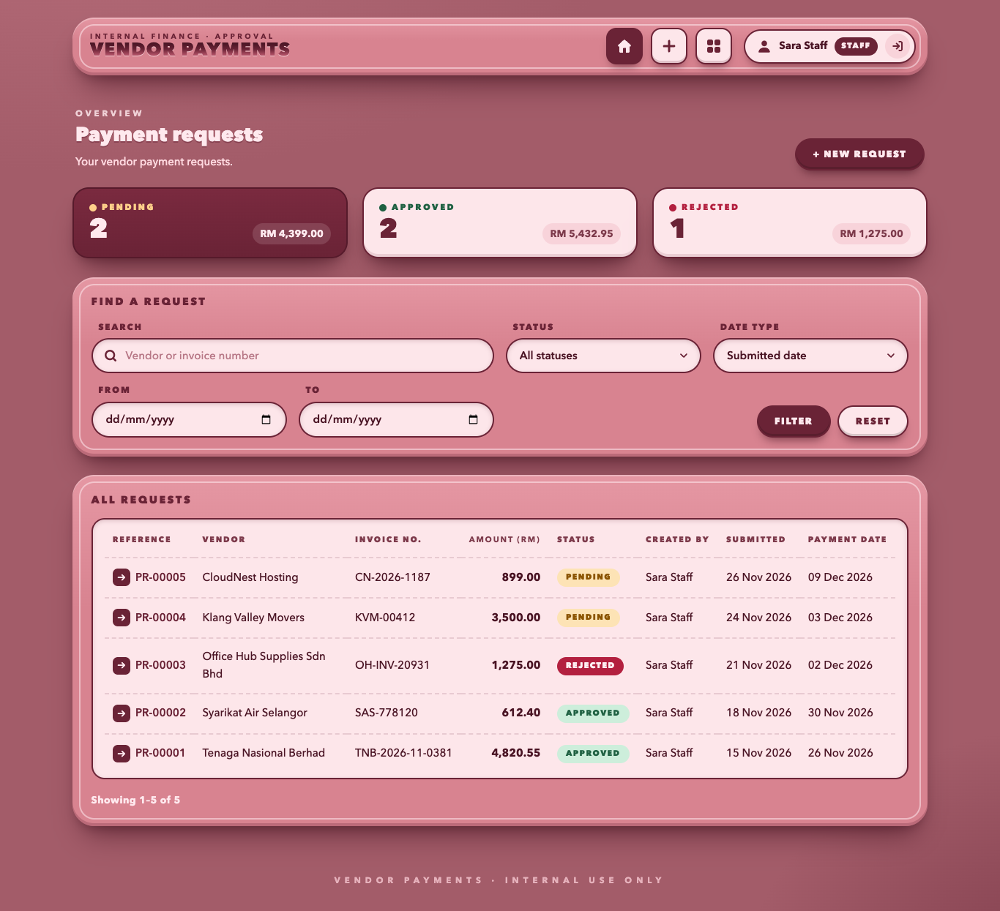 |
| **Form validation** (duplicate invoice, amount, date)<br>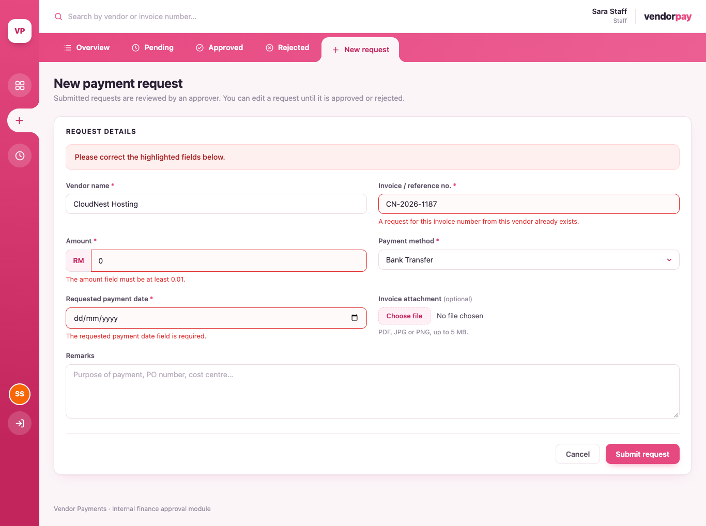 | **Staff request detail** after an edit, with the audit diff<br>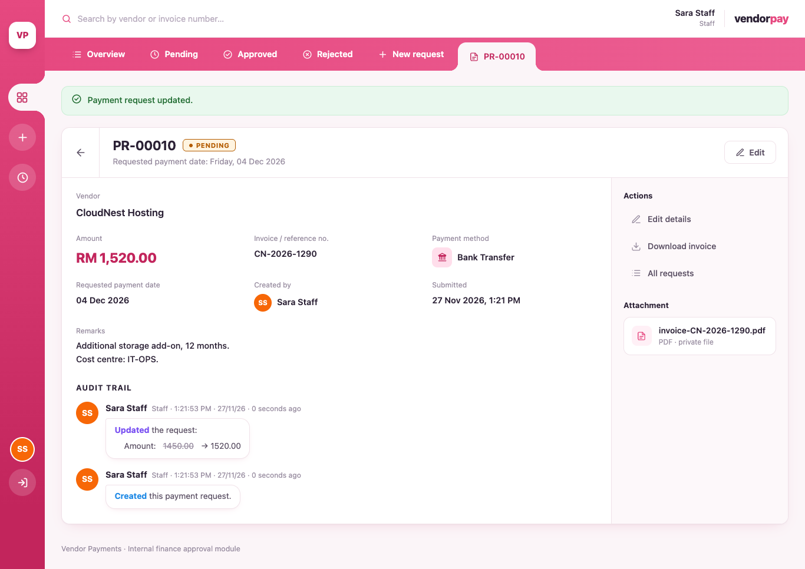 |
| **Approver dashboard** (all requests)<br> | **Approver review panel**<br>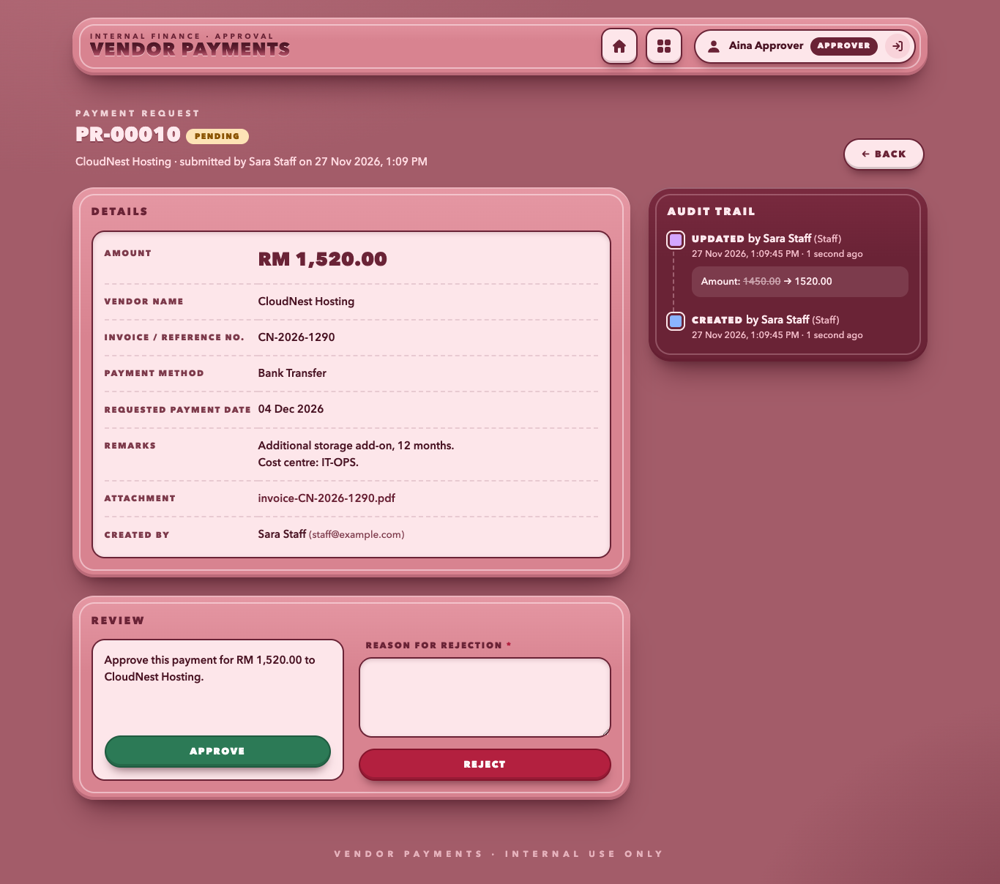 |
| **Rejection without a reason is refused**<br>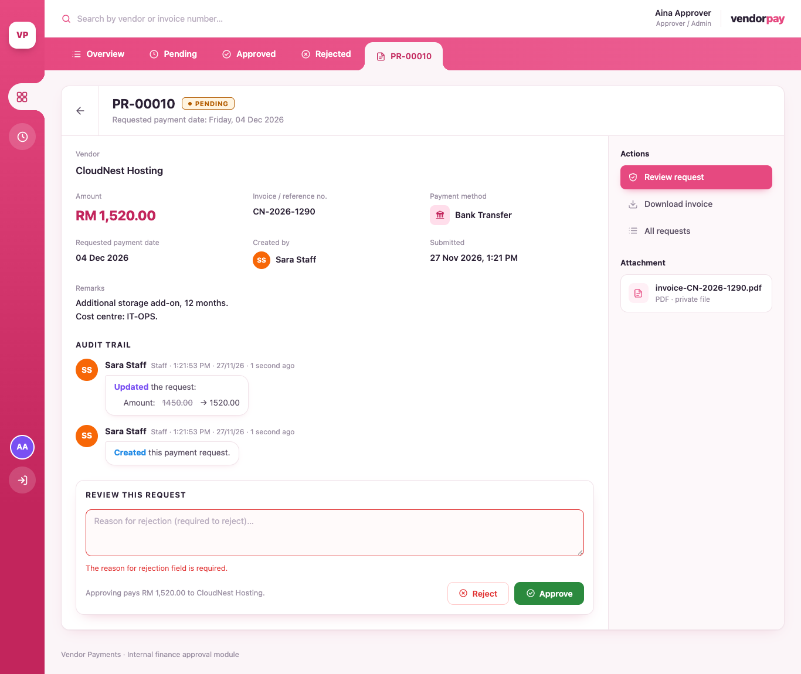 | **Rejected request with full audit trail**<br>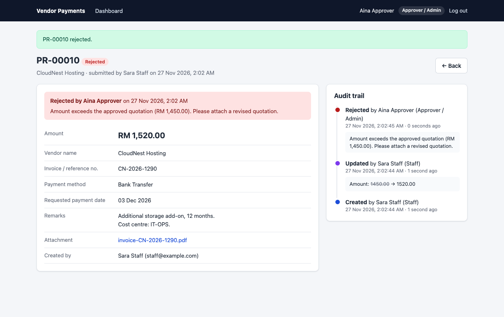 |
| **Filter by status**<br>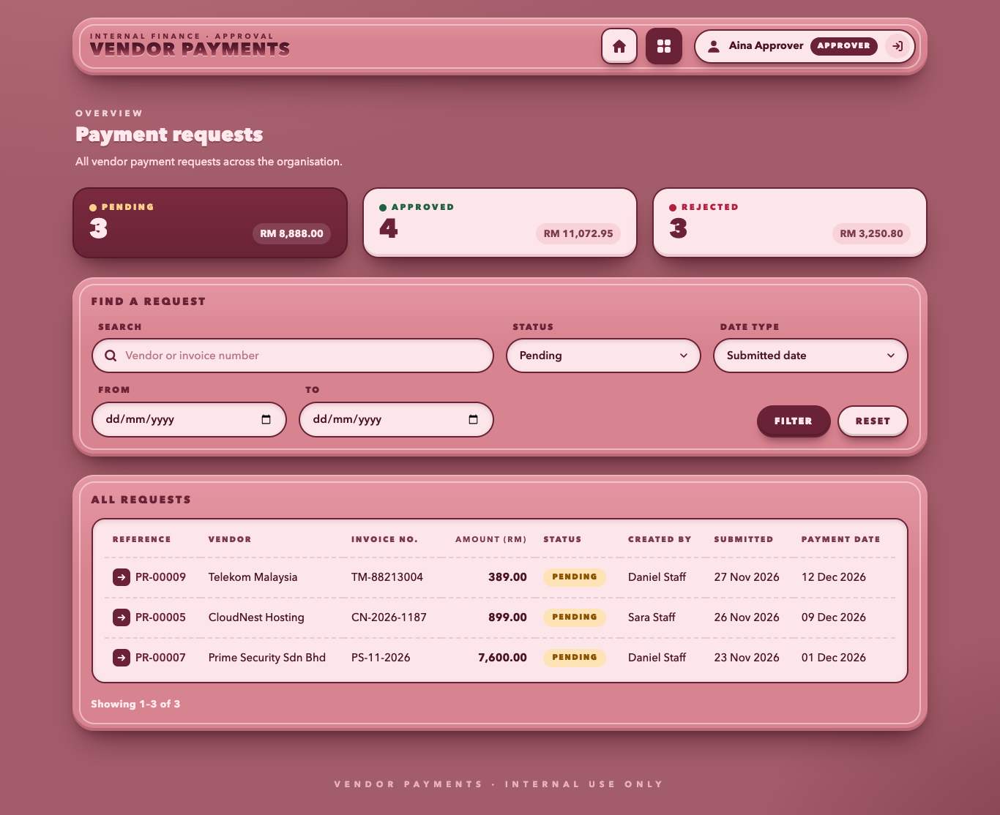 | **Search by vendor / invoice**<br>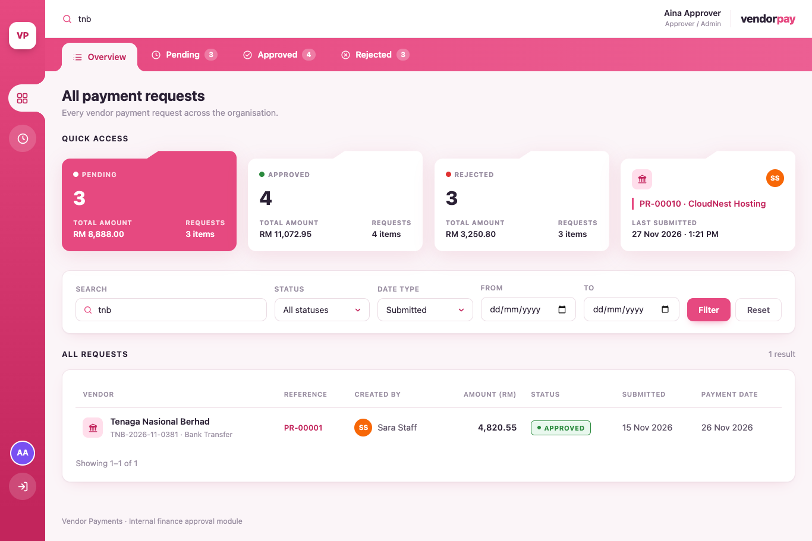 |
| **Staff view after rejection** (no Edit button)<br>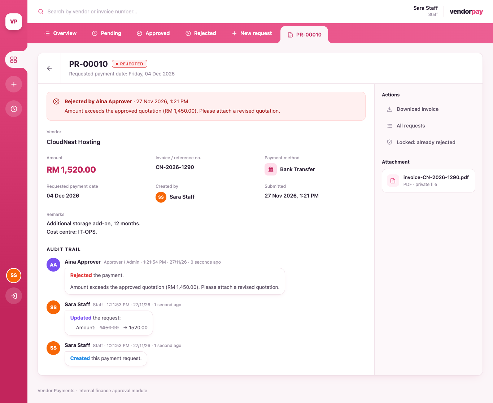 | **Mobile: detail page**<br>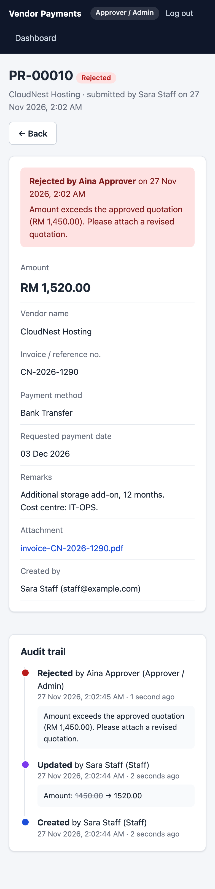 |
| **Mobile: dashboard** (table collapses to cards)<br>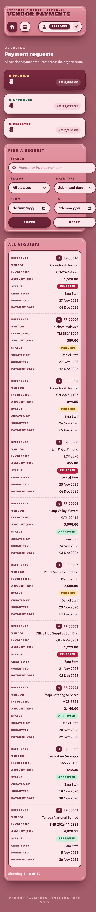 | |
# Vendor-Payment-Request-Approval-Module
